# Product Requirements Document (PRD)
## Dealer Order Platform — Nissan Used Vehicle Programme

**Document Version:** 1.0 (Based on Programme Brief v0.2)  
**Target Release:** Minimum Viable Product (MVP)  
**Client Stakeholders:** Autohub New Zealand & Nissan Motor Co.  
**Delivery Partner:** Creative Buffer  
**Date:** November 2026  

---

## 1. Executive Summary & Purpose

The **Dealer Order Platform (DOP)** is a dedicated, controlled self-service portal connecting approved **Nissan New Zealand franchise dealers** directly with **Nissan Japan export inventory**. 

Currently, vehicle sourcing, landed cost estimation, and order status inquiries rely on fragmented email threads, manual spreadsheets, and phone calls. This platform creates a single source of truth that:
1. Gives approved dealers transparent visibility into Japanese stock with **guaranteed dealer-specific landed pricing**.
2. Prevents double-booking via **server-side atomic vehicle reservation locks**.
3. Tracks door-to-door RoRo logistics and compliance across **9 standardized milestones**.
4. Clearly establishes the **commercial cost boundary** between fixed-price inclusions and separately chargeable compliance repairs.

---

## 2. Product Boundaries & Scope

### 2.1 In-Scope (MVP Deliverables)
- **Role-Based Authentication & Portal Access:** Dedicated interfaces for Dealers, Autohub Administrators, and Nissan Japan Inventory Specialists.
- **Dealer Onboarding & Mandatory Terms Acceptance:** Structured application capture with un-ticked, version-controlled commercial acknowledgements (US-01, US-02).
- **Vehicle Inventory Ingestion:** Single vehicle creation and bulk CSV/Excel upload with row-level validation (US-06, US-07).
- **Stock Catalogue & Filters:** Search by model, year, odometer, auction grade, fuel type/transmission, color, and stock ID.
- **Landed Pricing Engine:** Automated calculation of Total Buy Price based on dealer geographic pricing zone.
- **Atomic Reservation Lock:** Server-side concurrency control preventing near-simultaneous competing reservations (US-12, US-13).
- **Order Milestone Stepper:** 9-stage tracking from order confirmation to final dealership delivery.
- **Additional Cost Variation Approval:** Structured workflow for unexpected compliance repairs with photographic evidence upload and dealer approve/decline actions (US-18).
- **Programme Audit Log & Export:** Immutable logging of commercial and security events, with CSV/XLSX export (US-20, US-21).

### 2.2 Explicitly Out-of-Scope (Excluded from MVP)
- ❌ **Online Payment Processing & JPY Settlement:** No credit cards, direct debits, or foreign exchange execution.
- ❌ **Direct ERP & Accounting Ledger Integration:** No automated live syncing with Xero, MYOB, or Nissan global SAP.
- ❌ **Automated Shipping Line & Customs EDI APIs:** Milestone updates are managed administratively or via batch import.
- ❌ **Workshop Management & Repair Quoting Engine:** Beyond standard defect notification and quote approval.
- ❌ **Consumer-Facing Access & B2C Marketplace:** Strictly private B2B franchise dealer access.
- ❌ **Live Bidding Auctions & AI Analytics:** Live bidding feeds and predictive AI algorithms remain post-MVP.

### 2.3 Operational Data Ownership (Who Enters What?)

| Information | Entered / Managed by | System Component |
| :--- | :--- | :--- |
| Vehicle model, year, grade | Nissan Japan | Single / Batch Vehicle Ingestion |
| Chassis / VIN / Stock ID | Nissan Japan | Inventory Database Record |
| Odometer and specifications | Nissan Japan | Spec Sheet & JEVIC Certification |
| Vehicle photographs | Nissan Japan | Media Storage & 360 Gallery |
| Condition report and defects | Nissan Japan | Auction Grading & Defect Checklist |
| Vehicle acquisition cost | Nissan Japan, subject to confirmation | Baseline JPY FOB Wholesale Price |
| Geographic zones | Autohub Admin | Dealer Geographic Profiles (Zones 1–5) |
| Fixed-cost profiles | Autohub Admin | Ocean Freight & Marine Insurance Baseline |
| Standard delivery costs | Autohub Admin | Zone Transport Carrier Tariffs |
| Compliance cost components | Autohub Admin | MR2A Entry Inspection & WoF Schedule |
| Programme component | Autohub Admin | Certified Programme Governance Fee |
| Final dealer price calculation | Backend pricing engine | Automated Landed Price Calculation |
| Dealer-visible Total Buy Price | Dealer Portal | Guaranteed Landed Price Display |

---

## 3. Commercial Price Boundary & Geographic Pricing Zones

### 3.1 Official Geographic Pricing Zones
In accordance with programme logistics planning, five geographic zones dictate the domestic transport and delivery cost basis:

| Zone | Proposed Coverage | Major Locations Covered | Standard Delivery Profile |
|:---:|---|---|---|
| **Zone 1** | Upper North Island | Auckland, Northland | Direct Auckland port clearance & 2 metro carrier movements ($650 NZD) |
| **Zone 2** | Central North Island | Waikato, Bay of Plenty, Rotorua, Taupō | Auckland/Tauranga arrival + Central arterial transport ($850 NZD) |
| **Zone 3** | Lower North Island | Taranaki, Hawke's Bay, Gisborne, Manawatū, Wellington | Inter-regional linehaul transport to dealership depot ($1,150 NZD) |
| **Zone 4** | Upper South Island | Nelson, Marlborough, Canterbury | Lyttelton port arrival / Cook Strait coastal carrier ($1,450 NZD) |
| **Zone 5** | Lower South Island | West Coast, Otago, Southland | Long-haul lower South Island transport to regional hubs ($1,750 NZD) |

### 3.2 Fixed Landed Inclusions vs Separately Chargeable Items
|---|---|
| • Vehicle FOB acquisition cost (Japan) | • Non-standard compliance repairs (e.g. rust, seatbelt retractors) |
| • Standard RoRo marine freight & port charges | • Engineering certification & specialized LVVTA evidence |
| • NZ Customs clearance, import tariffs, & NZ GST | • Mechanical parts or diagnostic testing beyond standard MR2A |
| • Standard entry compliance inspection (MR2A pass) | • Border flag clearance (e.g. MPI bio-security contamination clean) |
| • Two standard NZ delivery carrier movements | • Demurrage, long-term port storage, or regional redeliveries |
| • Nissan programme component fee | • Dealer-requested accessories, tinting, modifications, or detailing |

> **Mandatory Platform Disclosure:** Fixed pricing assumes a clean pass under NZTA entry compliance rules. Any remedial repair work required to achieve MR2A certification will be documented with photos/evidence and submitted for dealer approval prior to work commencing.

---

## 4. Proposed 9-Stage Order Milestones

Every allocated vehicle progresses through nine sequential milestones:

```mermaid
flowchart LR
    M1[1. Order Confirmed] --> M2[2. Japan Verification]
    M2 --> M3[3. Booked for Shipping]
    M3 --> M4[4. In Transit / On Vessel]
    M4 --> M5[5. NZ Border Processing]
    M5 --> M6[6. Compliance Inspection]
    M6 --> M7[7. Additional Cost Review]
    M7 --> M8[8. Ready for Delivery]
    M8 --> M9[9. Delivered to Dealer]
```

1. **Order Confirmed:** Dealer submitted reservation; Autohub confirmed allocation.
2. **Japan Verification:** Yokohama yard completed physical check, deregistration documentation, and export preparation.
3. **Booked for Shipping:** Assigned to RoRo ocean carrier; vessel name and voyage number recorded.
4. **In Transit (On Vessel):** Vessel departed Japan port with estimated arrival date (ETA) at Auckland/Lyttelton.
5. **NZ Border Processing:** MPI biosecurity clearance and NZ Customs import release completed.
6. **Compliance Inspection:** Vehicle transferred to designated compliance center for initial MR2A evaluation.
7. **Awaiting Additional Cost Approval (Conditional):** Triggered only if unexpected repairs are required for MR2A certification.
8. **Ready for Delivery:** MR2A issued, final pre-delivery check completed, carrier dispatched.
9. **Delivered:** Handed over to dealership physical address with signed proof of delivery.

---

## 5. Minimum Data & Entity Model

- **Dealer:** `id`, `dealerCode`, `legalTradingName`, `nzbn`, `address`, `region`, `pricingZoneId`, `status` (`PENDING`, `APPROVED`, `SUSPENDED`), `termsVersion`, `termsAcceptedAt`.
- **User:** `id`, `name`, `email`, `role`, `dealerId`, `active`, `lastLoginAt`.
- **Vehicle:** `id`, `stockId`, `vinChassis`, `make`, `model`, `grade`, `year`, `odometerKm`, `transmission`, `color`, `fuelType`, `auctionGrade`, `images[]`, `conditionReportUrl`, `knownDefects[]`, `status` (`DRAFT`, `AVAILABLE`, `RESERVED`, `ALLOCATED`, `WITHDRAWN`, `SOLD`).
- **Reservation:** `id`, `vehicleId`, `dealerId`, `userId`, `reservedAt`, `expiresAt`, `status` (`PENDING_CONFIRMATION`, `ALLOCATED`, `EXPIRED`, `RELEASED`).
- **Order:** `id`, `orderNumber`, `vehicleId`, `dealerId`, `totalAgreedPriceNZD`, `currentMilestone`, `milestoneHistory[]`, `additionalCosts[]`, `etaDate`.
- **Audit Event:** `id`, `actorName`, `actorRole`, `action`, `category`, `objectId`, `beforeValues`, `afterValues`, `timestamp`.

---

## 6. Non-Functional Requirements (NFRs)

- **NFR-01 Security:** Role-based access control (RBAC), protected sessions, sanitised file uploads with MIME-type verification, zero plain-text credential leaks.
- **NFR-02 Concurrency (Atomic Lock):** Database transactions guarantee that two dealers clicking "Reserve" simultaneously will never result in duplicate reservations.
- **NFR-03 Performance:** Catalogue search and filter results render within 300ms on client cache; full API payload responses under 1 second.
- **NFR-04 Accessibility & UX:** WCAG AAA contrast ratio compliance on interactive controls, custom keyboard shortcut navigation (`/` focus), and responsive layout across desktop, tablet, and mobile.
- **NFR-05 Audit & Compliance:** All commercial acceptances, price assignments, and status updates are logged immutably with ISO timestamps and actor IDs.

