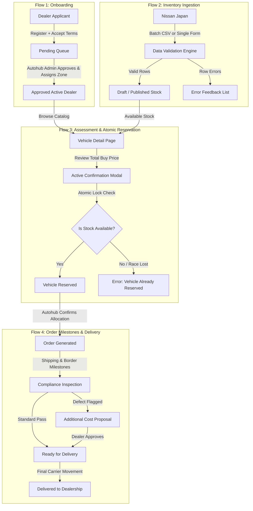
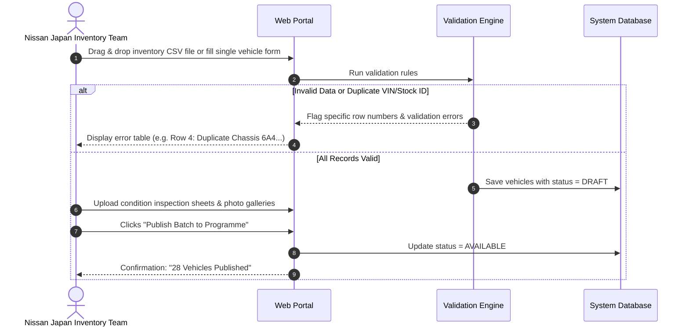
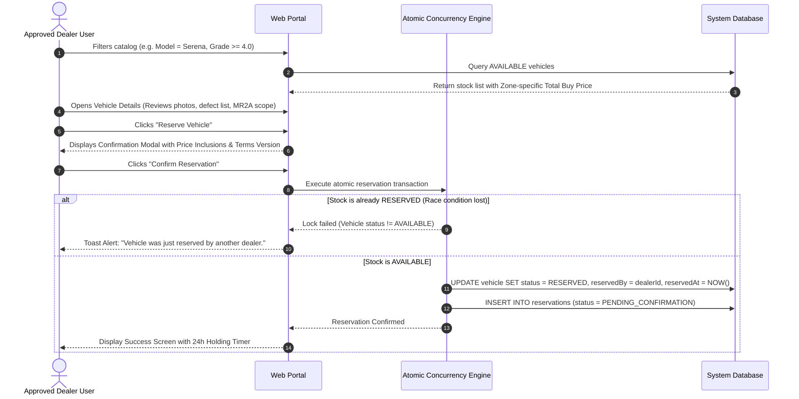

# End-to-End User Journeys & System Flows (USER_FLOWS.md)
## Dealer Order Platform — Nissan Used Vehicle Programme

**Document Version:** 1.0  
**Effective Date:** November 2026  

---

## 1. Flow Overview



---

## 2. Flow 1: Dealer Onboarding & Zone Assignment

```mermaid
sequenceDiagram
    autonumber
    actor Dealer as Dealer Applicant
    participant Portal as Web Portal
    participant DB as System Database
    actor Admin as Autohub Admin

    Dealer->>Portal: Enters Legal Name, Dealer Code, NZBN, Address & Contact
    Dealer->>Portal: Un-ticks & explicitly accepts Terms of Trade (v2026.1)
    Dealer->>Portal: Explicitly accepts Commercial Additional-Cost Boundary
    Portal->>DB: Record applicant, terms version, and UTC timestamp
    Portal-->>Dealer: Display "Pending Authorization" Screen (Catalogue Blocked)
    Admin->>Portal: Opens "Dealer Approvals" Dashboard
    Admin->>Portal: Reviews application & selects Geographic Pricing Zone (e.g. Zone 1)
    Admin->>Portal: Clicks "Approve Dealership"
    Portal->>DB: Update Dealer status = APPROVED, assign pricingZoneId
    Portal-->>Dealer: Send welcome approval notice; unlock Japan catalogue
```

### Key Acceptance Rules (US-01, US-02, US-03, US-04):
- Mandatory commercial checkboxes are **unticked by default**.
- Applicants cannot bypass the block screen until an Autohub Admin assigns a pricing zone.
- Changing a dealer's pricing zone is restricted to Autohub Administrators and is permanently logged in the audit trail.

---

## 3. Flow 2: Nissan Japan Stock Ingestion & Publication



### Validation Rules (US-06, US-07, US-08):
- Mandatory fields: Stock ID, VIN/Chassis, Model, Year, Odometer, Transmission, Auction Grade, Interior/Exterior Grade, Location.
- Duplicate detection: If an active vehicle already shares the same Stock ID or VIN, the incoming record is flagged.
- Status states: `Draft` $\rightarrow$ `Available` $\rightarrow$ `Reserved` $\rightarrow$ `Allocated` $\rightarrow$ `Withdrawn` $\rightarrow$ `Sold`.

---

## 4. Flow 3: Stock Discovery, Pricing Breakdown & Atomic Reservation



### Atomic Reservation Safeguard (US-12, US-13):
- Handled at the database transaction layer using conditional updates:
  ```sql
  UPDATE vehicles 
  SET status = 'RESERVED', reserved_by_dealer_id = :dealerId, reserved_at = NOW() 
  WHERE id = :vehicleId AND status = 'AVAILABLE';
  ```
- If rows affected is `0`, the request is rejected immediately, preventing any possibility of double reservation.

---

## 5. Flow 4: Order Milestone Progression & Additional Cost Variation

```mermaid
sequenceDiagram
    autonumber
    actor Admin as Autohub Administrator
    participant Portal as Web Portal
    participant DB as System Database
    actor Dealer as Approved Dealer

    Admin->>Portal: Views Pending Reservations queue
    Admin->>Portal: Clicks "Confirm Allocation"
    Portal->>DB: Create Order, set vehicle status = ALLOCATED, milestone = ORDER_CONFIRMED
    Portal-->>Dealer: Notify dealer: "Allocation Confirmed — Order #ORD-2026-084"
    
    rect rgb(240, 248, 255)
        Note over Admin,Dealer: Logistics Progression (Milestones 2 through 6)
        Admin->>Portal: Updates Milestone (Japan Verification -> Booked Shipping -> In Transit -> Border)
        Portal->>DB: Record milestone change, actor, and ETA timestamp
        Dealer->>Portal: Watches live tracking stepper in "My Orders"
    end

    rect rgb(255, 245, 245)
        Note over Admin,Dealer: Exception Branch: Unexpected Compliance Repair
        Admin->>Portal: Flags defect: "Driver seatbelt retractor failed MR2A check"
        Admin->>Portal: Enters cost: $480 NZD + uploads inspector certificate PDF
        Portal->>DB: Set milestone = AWAITING_ADDITIONAL_COST, create cost_item
        Portal-->>Dealer: Urgent Notification: "Additional Cost Approval Required"
        Dealer->>Portal: Reviews inspection photo evidence & price variation
        alt Dealer Approves
            Dealer->>Portal: Clicks "Approve Additional Cost"
            Portal->>DB: cost_item status = APPROVED, update total order amount
            Portal-->>Admin: Authorized to execute repair
        else Dealer Declines
            Dealer->>Portal: Clicks "Decline & Request Return to Available"
            Portal->>DB: cost_item status = DECLINED
            Portal-->>Admin: Alert: Dealer declined variation; initiate dispute/release
        end
    end

    Admin->>Portal: Advances Milestone to "Ready for Delivery" then "Delivered"
    Portal->>DB: Finalise Order, mark vehicle status = SOLD
    Portal-->>Dealer: Final delivery confirmation
```

