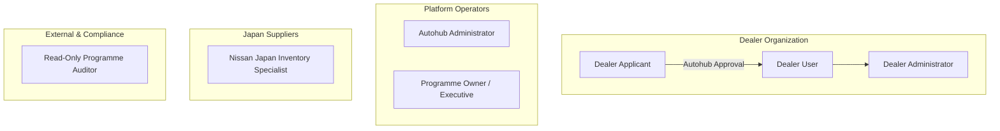

# User Roles & Access Control Specification (USER_ROLES.md)
## Dealer Order Platform — Nissan Used Vehicle Programme

**Document Version:** 1.0  
**Effective Date:** November 2026  

---

## 1. Access Principles

1. **Least Privilege:** Users only have access to data and actions strictly necessary to perform their operational duties.
2. **Dealer-Level Data Isolation (Tenant Boundary):** An approved dealer can only view their own reservations, orders, commercial pricing, and documents. Dealers cannot see other dealers' bids, allocations, or activity.
3. **Immediate Administrative Suspension:** Autohub administrators can immediately suspend a dealer's stock viewing or ordering privileges if terms are breached or account verification fails.
4. **Administrative Concealment:** Administrative features (approvals, pricing assignments, audit logs) are never rendered or exposed in dealer-facing navigation.
5. **Audited Privileged Actions:** Any state mutation affecting pricing profiles, dealer approvals, vehicle status, or cost additions is permanently timestamped and attributed.

---

## 2. Who Enters What? (Operational Data Ownership Matrix)

The following operational boundary matrix defines the official data entry and management responsibilities across programme participants:

| # | Information | Entered / Managed by | System Component & Implementation |
|---|:---|:---|:---|
| 1 | **Vehicle model, year, grade** | **Nissan Japan** | `components/japan/AddVehicleForm.tsx`, `BatchUploadView.tsx` |
| 2 | **Chassis / VIN / Stock ID** | **Nissan Japan** | `components/japan/AddVehicleForm.tsx`, `BatchUploadView.tsx` |
| 3 | **Odometer and specifications** | **Nissan Japan** | Technical spec inputs (Fuel, transmission, engine, km) |
| 4 | **Vehicle photographs** | **Nissan Japan** | Image gallery upload & 360 preview components |
| 5 | **Condition report and defects** | **Nissan Japan** | Certified auction grade sheet & defect map review |
| 6 | **Vehicle acquisition cost** | **Nissan Japan, subject to confirmation** | FOB JPY purchase price baseline |
| 7 | **Geographic zones** | **Autohub Admin** | `components/admin/DealerApprovalsView.tsx` (Zones 1–5) |
| 8 | **Fixed-cost profiles** | **Autohub Admin** | `lib/programme-context.tsx` (RoRo freight, insurance) |
| 9 | **Standard delivery costs** | **Autohub Admin** | Regional carrier linehaul matrix |
| 10 | **Compliance cost components** | **Autohub Admin** | MR2A entry inspection & 1-year WoF fee schedule |
| 11 | **Programme component** | **Autohub Admin** | Nissan NZ certified programme fee |
| 12 | **Final dealer price calculation** | **Backend pricing engine** | `calculateLandedPrice()` automated deterministic formula |
| 13 | **Dealer-visible Total Buy Price** | **Dealer Portal** | `components/dealer/DealerStockCatalog.tsx`, `FullPageVehicleDetail.tsx` |

---

## 3. Role Taxonomy & Descriptions

### 2.1 Dealer Applicant (`DEALER_APPLICANT`)
- **Status:** Unverified account pending Autohub validation.
- **Permissions:** 
  - Register dealership details (Name, NZBN, Dealer Code, Address, Contact Info).
  - Review and explicitly check mandatory Terms of Trade and Commercial Boundary acknowledgements.
- **Restrictions:** 
  - ⛔ Zero visibility into Japanese vehicle stock, prices, or orders.
  - ⛔ Cannot submit vehicle reservations until status transitions to `APPROVED`.

### 2.2 Dealer User (`DEALER_USER`)
- **Status:** Verified user attached to an approved Nissan NZ dealership.
- **Permissions:**
  - Search and filter available stock in the Japan export catalogue.
  - View full vehicle specifications, condition grade sheets, defects, and photos.
  - View dealer-specific Total Buy Price (derived from their assigned geographic zone).
  - Execute atomic vehicle reservation requests.
  - Track live progress of their dealership's active orders across the 9 milestones.
  - Approve or decline proposed additional compliance cost items with evidence review.
- **Restrictions:**
  - ⛔ Cannot view stock allocated to or reserved by competing dealerships.
  - ⛔ Cannot alter assigned geographic pricing zone or baseline pricing tables.
  - ⛔ Cannot create or invite new dealer users.

### 2.3 Dealer Administrator (`DEALER_ADMIN`)
- **Status:** Designated primary contact or dealer principal for an approved dealership.
- **Permissions:**
  - All standard permissions of `DEALER_USER`.
  - Maintain dealership contact information and physical delivery addresses.
  - Invite and manage authorized buyers/users within their dealership organisation.
- **Restrictions:**
  - ⛔ Cannot alter their own pricing zone or commercial margins.
  - ⛔ Cannot access platform administration or other dealerships' user rosters.

### 2.4 Autohub Administrator (`AUTOHUB_ADMIN`)
- **Status:** Platform operations and logistics manager at Autohub New Zealand.
- **Permissions:**
  - Review, approve, reject, or request revisions on incoming dealer applications.
  - Assign and modify geographic pricing zones and fixed delivery cost profiles for dealers.
  - Control stock publication status (`Draft` $\rightarrow$ `Available` $\rightarrow$ `Withdrawn`).
  - Confirm, reject, or release pending dealer vehicle reservation requests.
  - Advance orders through the 9 logistics and compliance milestones.
  - Upload proposed additional cost items with repair documentation/photographs.
  - Generate and export programme analytics and CSV/Excel reports.
- **Restrictions:**
  - ⛔ Cannot modify vehicle specifications or condition reports authored by Nissan Japan without audit logging.

### 2.5 Nissan Japan Inventory Specialist (`NISSAN_JAPAN`)
- **Status:** Logistics and vehicle preparation team member at Nissan Motor Co. (Yokohama).
- **Permissions:**
  - Create single vehicle listings with full technical specs, VIN/chassis, and odometer.
  - Execute batch CSV/Excel inventory uploads with row-level validation.
  - Upload certified inspection sheets, condition grades, and high-resolution photographs.
  - Mark export documentation and Japan yard verification milestones.
- **Restrictions:**
  - ⛔ Cannot view NZ dealer applications, identities, or NZ domestic delivery margins.
  - ⛔ Cannot approve or allocate dealer reservations.

### 2.6 Read-Only Programme User (`READONLY_AUDITOR`)
- **Status:** Nissan New Zealand national sales company or third-party compliance auditor.
- **Permissions:**
  - Read-only access to all stock listings, active orders, and delivery timelines.
  - View full system audit log (user logins, terms acceptance, price changes, allocations).
- **Restrictions:**
  - ⛔ Zero creation, editing, or state transition rights across any object.

---

## 3. Comprehensive Permissions Matrix

| Feature / Action | Applicant | Dealer User | Dealer Admin | Autohub Admin | Nissan Japan | Auditor |
|---|:---:|:---:|:---:|:---:|:---:|:---:|
| **Submit Dealership Application** | ✅ | — | — | — | — | — |
| **Accept Commercial Terms & Cost Boundary** | ✅ | ✅ | ✅ | — | — | — |
| **Browse Japan Stock Catalogue** | ❌ | ✅ | ✅ | ✅ | ✅ | ✅ |
| **View Dealer-Specific Landed Price** | ❌ | ✅ | ✅ | ✅ | ❌ | ✅ |
| **Submit Atomic Vehicle Reservation** | ❌ | ✅ | ✅ | ❌ | ❌ | ❌ |
| **View Own Dealership Orders & Milestones** | ❌ | ✅ | ✅ | ✅ | ❌ | ✅ |
| **Approve / Decline Additional Costs** | ❌ | ✅ | ✅ | ❌ | ❌ | ❌ |
| **Manage Dealership Users & Contacts** | ❌ | ❌ | ✅ | ❌ | ❌ | ❌ |
| **Approve / Reject Dealer Applications** | ❌ | ❌ | ❌ | ✅ | ❌ | ❌ |
| **Assign Geographic Pricing Zone** | ❌ | ❌ | ❌ | ✅ | ❌ | ❌ |
| **Confirm / Cancel Vehicle Allocation** | ❌ | ❌ | ❌ | ✅ | ❌ | ❌ |
| **Update 9-Stage Order Milestones & ETAs** | ❌ | ❌ | ❌ | ✅ | Partial (M2) | ❌ |
| **Propose Additional Repair Costs + Proof** | ❌ | ❌ | ❌ | ✅ | ❌ | ❌ |
| **Single Vehicle Entry & Media Upload** | ❌ | ❌ | ❌ | ❌ | ✅ | ❌ |
| **Batch CSV / Excel Inventory Ingestion** | ❌ | ❌ | ❌ | ❌ | ✅ | ❌ |
| **Export Programme Reports (CSV/XLSX)** | ❌ | ❌ | ❌ | ✅ | ❌ | ✅ |
| **Inspect System Security & Commercial Audit** | ❌ | ❌ | ❌ | ✅ | ❌ | ✅ |

---

## 4. Session Security & Multi-Tenant Rules

1. **Authentication:** Session tokens with automatic timeout after 8 hours of inactivity.
2. **Dealer Tenant Scoping:** All database queries for reservations, orders, and costs must enforce `WHERE dealerId = session.user.dealerId` for non-administrative roles.
3. **Impersonation / Role Switcher:** Available in staging/development mode only to facilitate end-to-end testing across personas without credential sharing.

